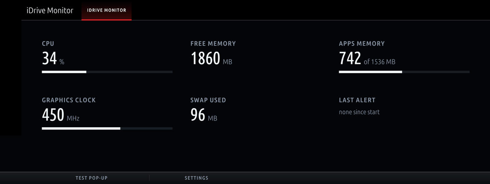
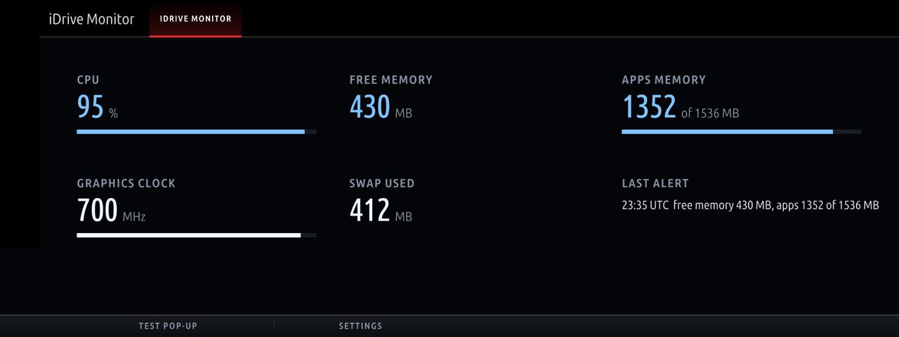
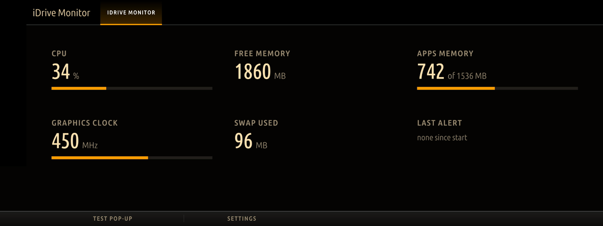

# mgu-apps

Apps and shared tools for the BMW iDrive 7 head unit (MGU), installed from the MGU Store:

- **iDrive Monitor** (`jap_sysmon`): the head unit's CPU, memory and graphics load, with a pop-up when it runs short.
- **Tailscale** (`jap-tailscale`): your tailnet on the head unit, through a local SOCKS5 proxy. Moonride uses it to
  play over 5G.
- **Node.js 22** (`jap-node22`): the Node runtime that the background services of Moonride and RideTube run on.

The two tools live only here, so the Store never sees the same tool id from two sources. Moonride and RideTube
require `jap-node22` from this source.



*iDrive Monitor on a quiet head unit.*



*When the iDrive runs short: the values over a limit change colour and the last alert stays on the page.*



*The Night Amber colour theme.*

(Drawn offline by the head unit's renderer, with demo values.)

Independent project, not affiliated with or endorsed by BMW, Tailscale Inc. or the OpenJS Foundation. The
Tailscale package is an unofficial build of Tailscale's open-source client. Use at your own risk.

Tested on one car: BMW X5 xDrive45e (G05), iDrive 7 (MGU, ID7 HMI), firmware P18_23w44.2-1-3. Reports from other
cars are welcome in the issues.

## Requirements

- A BMW with iDrive 7 (MGU, `ID7`) and the [MGU Store](https://github.com/robertnisipeanu/mgu-store) installed.
- From the Store's own source: the renderer `mgu-render` 0.6.11 or newer, `mgu-deploy` 0.7.0 (for the tools) and,
  for Tailscale, `mgu-uplink` with an internet connection. From the Store's default
  `cauliflowermossgrape/idrive7-apps` source: the controller gate `mgu-inputgate` (for iDrive Monitor). The Store
  installs requirements first; keep those sources in the Store, or the install stops with a missing requirement.

## Install

In the MGU Store, add the source

```
JustAnotherPU/mgu-apps:releases
```

(the `catalog` release of this repository), then install iDrive Monitor or Tailscale. You don't need to install
Node.js 22 yourself: the Store installs it when an app needs it. The packages are prebuilt. The BMW SDK module is
not in them: the head unit makes it from an app already on the car.

## iDrive Monitor

It shows the head unit's CPU, free memory, the apps' memory against their cap, swap and the graphics clock on
one page. It raises a short pop-up when the iDrive runs short:

- CPU at 90 % or more for 30 s
- under 500 MB free
- the apps at 1300 MB of their cap, or the cap refusing memory

At most one pop-up comes every 10 minutes, and none while reversing. It starts with the head unit, so the check
runs without opening the app. It reads three small system files every 10 s and nothing else.

Settings:

- **Pop-up when the iDrive is short of resources**: on by default.
- **Colour theme**.
- The page's *Test pop-up* button shows the pop-up once.

Known limits:

- The thresholds are fixed (see above). They were chosen on one car.
- The graphics clock is shown but never alerted on, because the GPU never idles on this unit.


## Tailscale

`jap-tailscale` runs Tailscale 1.104.4, built from the upstream tag, on the head unit. It gives programs on the
head unit outgoing access to your tailnet through a SOCKS5 proxy on `127.0.0.1:1065`. Moonride relays its stream
through it when your PC is not on the car's network (Moonride's README, "Playing over 5G").

1. Give the car internet through mgu-uplink (a phone hotspot, an LTE stick, ...).
2. Install **Tailscale** from the MGU Store.
3. In Moonride, open **•••**. A Tailscale sign-in button appears while the tool waits for a login. Tap it
   and scan the QR code with a phone that is signed in to your Tailscale account, then approve the device
   (`idrive`). Complete the login promptly: until it is done, the login link is a claim credential that every
   app on the head unit can read (whoever opens it first can add the car to their tailnet).
   Consider turning off key expiry for it in the Tailscale admin console.

How the tool works, and how to keep it safe:

- The head unit's kernel has no TUN device, so Tailscale runs in **userspace networking**. The kernel routes
  nothing into the tailnet; programs reach it through the SOCKS5 proxy.
- The SOCKS5 proxy listens on `127.0.0.1` only, so nothing outside the head unit can use it. It has **no
  authentication**. Any program on the head unit (every installed app or tool) can use it to reach your tailnet.
  Because the car accepts subnet routes, it can also reach your home network behind a subnet router. That is why
  the tailnet policy below matters: it decides what the car can reach.
- The Tailscale control socket is private (root and the service only), so apps cannot log the car in or out.
- **Incoming connections are refused** (`--shields-up`). In userspace networking, Tailscale would otherwise hand
  incoming tailnet connections to the head unit's own local services.
- **Remote access over SSH is not offered.** Because of shields-up, no device in your tailnet can open a
  connection to the car. That includes SSH to the head unit and Tailscale SSH. Turning shields-up off
  (`jap-ts set --shields-up=false`) would expose the head unit's local services to your tailnet. It is untested on
  the car and not recommended. If you do it, allow only one admin device to reach the car in your policy.
- Keep the shields up, and also limit the car in your tailnet policy. For example, tag the car `tag:car`
  (Machines › the car › Edit ACL tags). Then allow the car to reach your PC on Moonlight's ports, and nothing to
  reach the car:

  ```json
  {
    "tagOwners": { "tag:car": ["autogroup:admin"] },
    "grants": [
      { "src": ["tag:car"], "dst": ["<your PC or subnet>"],
        "ip": ["tcp:47984", "tcp:47989", "tcp:47990", "tcp:48010", "udp:47998-48000"] }
    ]
  }
  ```

  No grant has `tag:car` as its destination, so no device in your tailnet can open a connection to the car.
- From a root shell on the head unit (SSH on the car's own network), `/var/opt/jap-tailscale/current/jap-ts` is
  the `tailscale` CLI of this daemon. For example: `jap-ts status`, `jap-ts logout`, or a login with an
  [auth key](https://tailscale.com/kb/1085/auth-keys) that you keep in a root-only file:
  `jap-ts up --auth-key=file:/path/to/key --hostname=idrive --accept-routes --accept-dns=false --shields-up`.
  Never put an auth key in a repository or a shared file.
- The tool has its own state, socket, service (`jap-tailscale.service`, uid 3920) and a random WireGuard port, so
  it can run beside another Tailscale tool on the same head unit.

## Node.js 22

`jap-node22` is Node.js 22.23.4 from nodejs.org's unofficial-builds `linux-x64-glibc-217` flavour. The unit has
glibc 2.27, and the official build needs 2.28. It installs to `/var/opt/jap-node22/current/bin/node` and changes
nothing else: BMW's apps keep the system Node 8. Moonride's service (`jap-moonride`) and RideTube's service
(`jap-ridetube-d`) require it and call it by that path. See [tools/jap-node22/README.md](tools/jap-node22/README.md).

## Repository layout

| Path | |
|---|---|
| `apps/jap_sysmon` | iDrive Monitor (Node 8, the iDrive's own app runtime) |
| `kit/` | the idrive7-apps app kit, trimmed to what iDrive Monitor uses |
| `tools/jap-tailscale` | the Tailscale tool: manifest, unit, scripts, `jap-runas`, build script |
| `tools/jap-node22` | the Node.js 22 tool: manifest, build script (downloads and checks the pinned build) |
| `release/` | makes the Store release (`catalog.json` and the artifacts) |

## Build and test on a computer

```sh
node kit/tools/test_runtime.js && node kit/tools/test_life.js && node kit/tools/test_sysmon.js
```

The tests need a current Node (18 or newer). The app itself runs on the head unit's Node 8.

A release needs an `oap-sdk` folder extracted from a BMW app you own (`node kit/tools/extract_sdk.js
<javascript/app.js of a BMW app>`, which writes `./oap-sdk`; never commit it). It also needs Docker (on a Mac:
colima, with `TMPDIR` outside `/var/folders`) and a checkout of the MGU Store for its packer:

```sh
export MGU_STORE=<a clone of the MGU Store>
python3 kit/tools/build.py jap_sysmon        # dist/jap_sysmon@<version>.tgz
sh tools/jap-node22/build.sh                 # dist/jap-node22@<version>.tgz
sh tools/jap-tailscale/build.sh              # dist/jap-tailscale@<version>.tgz
sh release/release.sh                        # dist/release/: catalog.json + artifacts (no oap-sdk)
```

## Releasing

Make a GitHub release named `catalog` (tag `catalog`) and upload every file of `dist/release/`: `catalog.json`,
the three `.tgz` artifacts and `jap_sysmon.png`. The Store reads `catalog.json` from that release and checks every
download against its size and sha256. For a new version, run `release/release.sh` again and replace the release's
files. No binary is committed to this repository.

## License

MIT, Copyright (c) 2026 JustAnotherPU ([LICENSE](LICENSE)), except:

- `tools/jap-tailscale` (its scripts and `jap-runas`) and `tools/jap-node22/set-loader.js`: GPL-3.0-or-later
  ([tools/jap-tailscale/COPYING](tools/jap-tailscale/COPYING)).
- The app kit in `kit/` (MIT), Tailscale (BSD-3-Clause) and Node.js (MIT and others): see
  [THIRD_PARTY_LICENSES](THIRD_PARTY_LICENSES). Each tool package carries the licences of what it ships.
